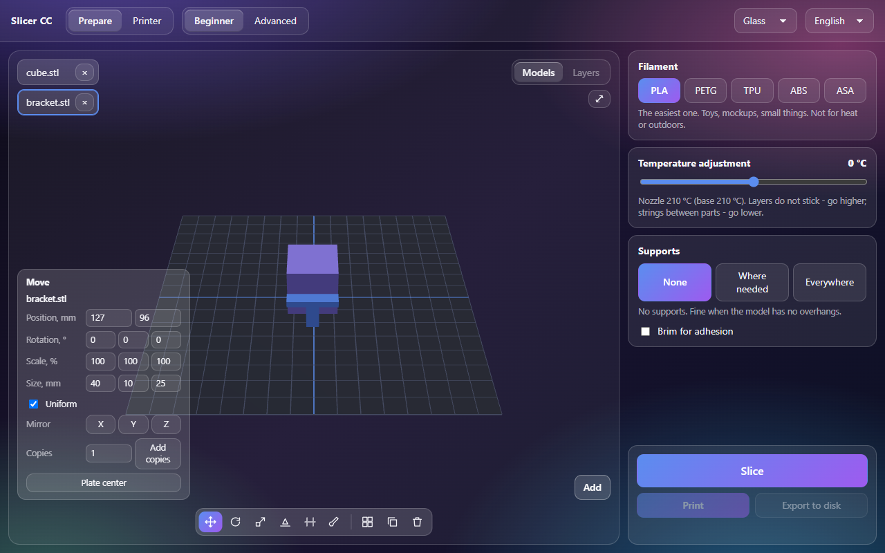
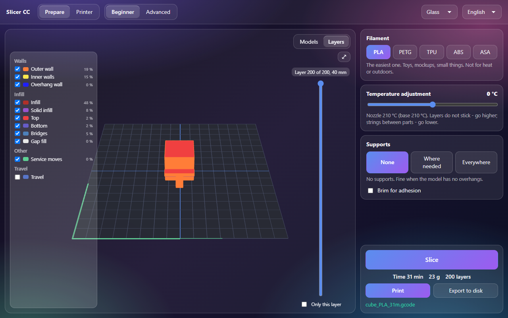

# Slicer CC

A slicer for one printer, the Elegoo Centauri Carbon. Slicing is done by the proven ElegooSlicer engine (an OrcaSlicer fork);
the program adds two things Elegoo Slicer lacks:

1. **Beginner mode**: three decisions instead of hundreds of settings - filament, temperature adjustment, supports (with a
   brim switch). Everything else is the maker's base for the Centauri Carbon 0.4 nozzle at 0.20 mm. Advanced mode shows
   every engine setting with search.
2. **Reliable sending**: the print starts only after the printer itself lists the file and the size matches. A dropped
   connection, a cut file or a file that never shows up is retried up to three times, with a plain message about what happened.

[Русский](README.ru.md)

[](https://claude.com/claude-code)
Code, tests and docs are written by Claude (Anthropic) in Claude Code. Ideas, testing and decisions - Alexey.

**Status: not released yet.** Version 0.2.0 waits for Alexey's check on a real printer, so there is no installer or
GitHub release yet. To try it from source: `npm install`, then `npm start`. The slicing engine is ElegooSlicer, installed
in Program Files (or set `SLICER_ENGINE` to its `elegoo-slicer.exe`).

 

## Found by measurement (2026-10-17, ElegooSlicer 1.5.3.5)

| What | Before | Done |
|---|---|---|
| The engine does not resolve the whole `inherits` chain of a preset passed as a file | `filament_density: 0`, outer wall acceleration 1000 instead of 5000, a cube takes 18 min instead of 10; "Generic PETG @System" bed 45 °C instead of 80 | The chain is resolved here (`src/core/presets.js`), the engine gets full presets without `inherits` |
| Printer preset with `"from": "User"` and no `inherits` | Refused, exit code 127 | Always `"from": "system"` in the job |
| Small binary STL with zero normals | Cubes of 10-15 mm fail to load, 16 mm and up slice. admesh treats a file as ASCII if the 128 bytes after the header have no byte > 127 | The job copy gets -0.0 in the first facet normal (the same zero, byte 0x80) |
| Full model path | Ended up in the G-code (`EXCLUDE_OBJECT_DEFINE NAME=C_/Users/...`) | Models are copied into the job folder under neutral names |
| An Elegoo/Orca project 3MF with external settings | The engine crashes (0xC0000005) | The engine gets only our plate 3MF: models already in plate coordinates, painted supports as `paint_supports` |
| Painted supports with supports off | No supports | None + paint = `tree(manual)`: supports only where painted |
| Models that do not fit | The engine silently made `plate_2.gcode`, only the first plate was printed | Refused with `plates` / `off-bed` and the names |
| ElegooSlicer file names | `ECC_0.4_旋转花瓶E_Generic PETG _0.2_4h20m.gcode` - spaces, CJK | Printer name only from `[A-Za-z0-9_.-]`, at most 60 chars, Cyrillic transliterated |

## Models on the plate (0.2)

The plate in the window is the print plate: models are sliced exactly where they stand (one plate 3MF, engine with `--arrange 0`).

- **Mouse**: click to select (Ctrl for several), drag to move. Rotate and scale handles on the Rotate and Scale tools.
- **Numbers**: position X/Y, rotation X/Y/Z in degrees, scale in %, size in mm (uniform or one axis).
- **Lay on face**: click a face or use "Largest face".
- **Mirror** X/Y/Z, **copies**, **align** several (edges and centers), **plate center**, **arrange**. If not everything fits,
  "4 of 10 fit on the plate", the rest stand red to the right and slicing refuses with their names (the engine used to put the
  rest on a second plate silently and only the first was printed).
- **Cut** by height: both parts get a cap (with a hole for hollow models), the upper part can lie cut side down.
- **Paint supports**: Add, Block, Erase, brush size. Large faces are split for the brush (each triangle into 4, the mesh stays closed).
- 3MF from Elegoo Slicer, Orca and Bambu Studio open with their models, placement, rotation and scale; modifier parts are
  not printed (the program says so).

## Layers

After slicing the view switches to Layers: a layer slider ("Layer 10 of 100, 2 mm"), "Only this layer", a legend by groups
(walls, infill, supports, adhesion, other, travel) with Orca-like colors, check boxes and time share. Any change of models or
choices turns layers and Print off: the slice is out of date.

## Advanced

244 settings in sections, each with a label and a plain description (RU/EN), search by label, description and engine name.
Input is checked at once: a comma means a dot, "abc" or "5" for the layer height is not stored. Filament changes are kept per
filament. If the engine still rejects a value, the program names the setting (the engine writes the reason into its `00000.log`).

## Printer control

Axes X/Y/Z with 0.1/1/10/50 mm steps, Home (all and per axis), coordinates, nozzle (0-350) and bed (0-110) temperatures,
three fans, light, print speed - the same commands as the printer web page inside Elegoo Slicer: 401 axes (Z "up" is a negative
step), 402 home, 403 temperatures, fans, light, speed. **While printing, paused, heating or offline the axes and Home are
disabled** - in the window (with the reason) and in the main process (nothing is sent). Heating asks first. Tested on the fake
printer; not yet on the real one.

## Sending

SDCP like Elegoo Slicer: WebSocket `ws://<ip>:3030/websocket` for commands and `POST http://<ip>:3030/uploadFile/upload`
for the file (1 MB chunks, MD5 of the whole file in each). Busy printer - refused before upload. A name not yet on the
printer, so an old file cannot pass the check. The start command is sent **once**. The camera is only ever enabled: SDCP 386
`Enable: 0` cuts the video for everyone and is refused in `src/core/sdcp.js`, guarded by a law.

## Tests

```
npm test           # core laws: 63 tests (node:test + fast-check), with the real engine when installed
npm run test:app   # the real Electron window, invisible: 12 tests
npm run mutate     # 17 mutants, all must be caught
```

The printer in tests is a fake (`tests/support/fake-printer.js`) with faults on demand. Law over random fault mixes: at most
one start, nobody disables the camera, success means the printer holds the file byte for byte.
