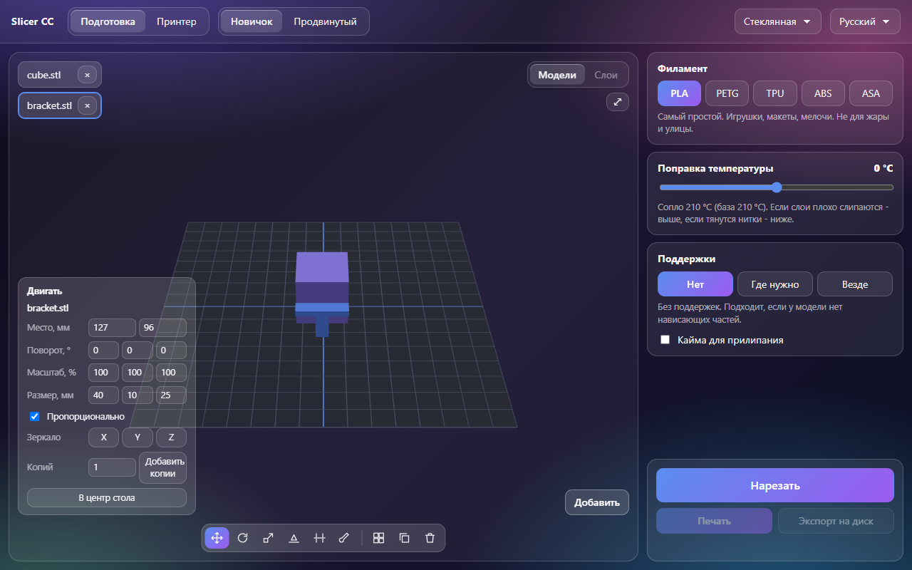
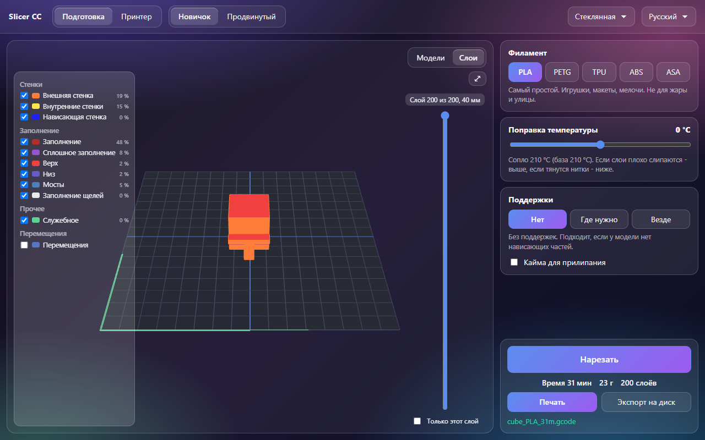

# Slicer CC

Слайсер для одного принтера - Elegoo Centauri Carbon. Режет проверенный движок ElegooSlicer (форк OrcaSlicer), а программа
делает две вещи, которых в Elegoo Slicer не хватает:

1. **Режим «Новичок»**: три решения вместо сотен настроек - филамент, поправка температуры, поддержки (с переключателем
   «Кайма»). Остальное - база производителя для Centauri Carbon 0.4 и 0.20 мм. Для «Продвинутого» есть все настройки
   движка с поиском.
2. **Надёжная отправка на принтер**: печать стартует только когда принтер сам показал файл в своём списке и размер совпал.
   Обрыв, обрезанный файл, файл не появился - повтор, до трёх раз, и понятный текст, что случилось.

[English](README.md)

[](LICENSE) [](#) [](https://claude.com/claude-code)

Код, тесты и документация этого проекта написаны Claude (Anthropic) в Claude Code. Идеи, проверка и решения - Алексей.

**Состояние: ещё не выпущена.** Версия 0.2.0 ждёт проверки Алексея на настоящем принтере, поэтому установщика и выпуска
на GitHub пока нет. Попробовать из исходников: `npm install`, потом `npm start`. Движок нарезки - ElegooSlicer, установленный
в Program Files (или путь к его `elegoo-slicer.exe` в переменной `SLICER_ENGINE`).

 

## Почему так

Две жалобы, с которых всё началось: в Orca «очень много настроек, глаза разбегаются», и файлы из слайсера «криво
скидываются и там могут не отображаться, приходится скидывать раз 5». Качество печати Elegoo Slicer при этом устраивает,
поэтому своя нарезка не пишется: программа отдаёт модель тому же движку, что стоит у Elegoo Slicer.

## Что выяснилось замерами (17.10.2026, ElegooSlicer 1.5.3.5)

| Что | Как было | Что сделано |
|---|---|---|
| Движок, получив системный пресет файлом, не разворачивает цепочку `inherits` до конца | `filament_density: 0`, ускорение внешней стенки 1000 вместо 5000, время куба 18 мин вместо 10; у «Generic PETG @System» стол 45 °C вместо 80 | Цепочку собираем сами (`src/core/presets.js`) и отдаём движку полный пресет без `inherits` |
| Пресет принтера с `"from": "User"` без `inherits` | Движок отказывает, код 127 | В задании всегда `"from": "system"` |
| Двоичный STL маленькой модели с нулевыми нормалями | Кубы 10-15 мм: «Loading of a model file failed», 16 мм и больше режутся. admesh считает файл текстовым, если в 128 байтах после заголовка нет байта > 127 | В копии задания нормаль первой грани -0.0 (тот же ноль, байт 0x80) |
| Полный путь модели | Попадал в G-code (`EXCLUDE_OBJECT_DEFINE NAME=C_/Users/...`) | Модели копируются в папку задания под нейтральными именами |
| Имена файлов ElegooSlicer | `ECC_0.4_旋转花瓶E_Generic PETG _0.2_4h20m.gcode` - пробелы, иероглифы | Имя на принтере только из `[A-Za-z0-9_.-]`, не длиннее 60, кириллица транслитом: `Vaza_spiralnaya_PETG_4h20m.gcode` |
| Свой 3MF-проект Elegoo/Orca с внешними настройками | Движок падает (0xC0000005) | В движок идёт только наш 3MF стола: модели уже в координатах стола, раскраска поддержек атрибутом `paint_supports` |
| Раскраска «ставить поддержки» при выключенных поддержках | Поддержек нет | «Нет» + раскраска = `tree(manual)`: поддержки только по раскраске |
| Модели не влезли на стол | Движок молча делал `plate_2.gcode`, печаталась только первая пластина | Отказ `plates` / `off-bed` с именами |
| Пустой статус принтера | Ронял панель принтера целиком (`Number(null) === 0`) | Закон на 300 случайных статусах |

## Модели на столе (0.2)

Стол в окне - это и есть стол печати: модели режутся ровно там, где стоят (один 3MF стола, движок с `--arrange 0`).

- **Мышью**: щёлкнуть - выбрать (с Ctrl - несколько), тянуть - двигать по столу. Ручки поворота и масштаба на
  инструментах «Повернуть» и «Размер».
- **Числами**: место X/Y, поворот X/Y/Z в градусах, масштаб в %, размер в мм (пропорционально или по одной оси).
- **Гранью на стол**: щёлкнуть по грани модели или «Самой большой гранью».
- **Зеркало** X/Y/Z, **копии**, **выравнивание** нескольких (края и центры), **в центр стола**, **разложить по столу**.
  Не влезло на стол - «На стол влезло 4 из 10», лишние стоят справа от стола красными, нарезка отказывает с их именами
  (движок молча раскладывал лишнее на вторую пластину и печаталась только первая).
- **Разрезать** по высоте: обе части закрыты крышкой (и с дыркой, если модель полая), верхнюю можно положить срезом вниз.
- **Поддержки кистью**: «Ставить», «Запретить», «Стереть», размер кисти. Крупные грани под кисть мельчатся (каждый
  треугольник на 4, сетка остаётся замкнутой).
- **Ластик - отличие от Orca и Elegoo Slicer**: «Стереть» - отдельная кнопка рядом со «Ставить», ей стирается часть мазка
  (только там, где прошла кисть, остальное остаётся). В Orca и Elegoo Slicer стирание спрятано за Shift + мышь, а «Очистить»
  стирает всё сразу. «Очистить» здесь - у выбранных моделей; без выбора - сначала вопрос.
- **Отмена**: Ctrl+Z / Ctrl+Y (и кнопки на панели инструментов) для всех правок стола - удаление, перемещение, числа,
  «Разложить», разрез, копии, кисть - и для выбора «Новичка» и правок «Продвинутого». Ctrl+A - выбрать все модели.
- 3MF из Elegoo Slicer, Orca и Bambu Studio открываются с моделями, их местом, поворотом и масштабом; детали-модификаторы
  не печатаются (о них пишется).

## Слои

После нарезки окно переключается на «Слои»: ползунок слоя («Слой 10 из 100, 2 мм»), «Только этот слой», легенда по группам
(стенки, заполнение, поддержки, прилипание, прочее, перемещения) с цветами как у Orca, галочками и долей времени. Любое
изменение моделей или выбора гасит слои и «Печать»: нарезка устарела.

## «Продвинутый»

Больше 230 настроек (в окне - те из 244 ключей каталога, что есть у пресетов принтера) по разделам (качество и слои, стенки, верх и низ, заполнение, скорость, ускорения, температуры, охлаждение,
откат, поддержки, адгезия, особые режимы, филамент, прочее), у каждой - подпись и описание простыми словами (RU/EN), поиск
по подписи, описанию и имени движка. Ввод проверяется сразу: запятая понимается как точка, «abc» и «5» для высоты слоя не
сохраняются. Правки филамента хранятся для каждого филамента отдельно (сопло 215 у PETG больше не уезжает в PLA). Если
движок всё же не принял значение, программа называет настройку (движок пишет причину в свой журнал `00000.log`, а не в вывод).

## Управление принтером

Оси X/Y/Z с шагом 0.1/1/10/50 мм, «Домой» (все и по осям), координаты, температуры сопла (0-350) и стола (0-110), три
вентилятора, свет, скорость печати. Команды - как у веб-страницы принтера в Elegoo Slicer (`resources/web/elegoolink/
lan_service_web`): 401 оси (Z «вверх» - отрицательный шаг), 402 домой, 403 температуры, вентиляторы, свет, скорость.
**Во время печати, паузы, нагрева и без связи оси и «Домой» недоступны** - и в окне (с подписью почему), и в главном
процессе (команда не уходит). Нагрев - только после подтверждения. Проверено на поддельном принтере; на настоящем - ещё нет.

## Отправка на принтер

Протокол SDCP, как у Elegoo Slicer: WebSocket `ws://<ip>:3030/websocket` для команд и
`POST http://<ip>:3030/uploadFile/upload` для файла (куски по 1 МБ, MD5 всего файла в каждом куске). Порядок:

1. Связь и статус. Принтер печатает или на паузе - отказ до загрузки.
2. Имя, которого ещё нет на принтере: иначе проверка «файл виден» нашла бы старый файл с тем же именем.
3. Загрузка. Кусок без ответа повторяется на месте до трёх раз.
4. Проверка: ждём файл в списке принтера (до 20 с). Если принтер сообщает размер - он должен совпасть.
5. Не совпало или не появился - загрузка целиком заново, всего до трёх попыток.
6. Старт печати - **один раз**. Нет ответа - ждём, что принтер сам ушёл из простоя, и второй раз не шлём.

Камеру программа только включает. Команду «выключить поток» (SDCP 386 `Enable: 0`) не шлёт никогда: она обрывает видео всем,
кто его смотрит (Elegoo Slicer, веб-страница принтера, AiForPrinter). Запрет стоит в единственном месте, где собираются
запросы (`src/core/sdcp.js`), и проверяется законом.

## «Новичок»

| Решение | Что меняет в движке |
|---|---|
| Филамент | PLA - «Generic PLA @Elegoo Centauri», PETG - «Generic PETG @System» с правками проверенного пресета (стол 80, откат 1.8, подъём 1.2, обдув 0-80 %), TPU/ABS/ASA - «Elegoo … @ECC» (значения производителя, помечены как непроверенные) |
| Поправка температуры | `nozzle_temperature` и первый слой: база ± 15 °C |
| Поддержки | «Нет»; «Где нужно» - деревья только от стола; «Везде» - и от модели. «Кайма» - `outer_only`, 5 мм |

Правки «Продвинутого» (качество, пластина, любые ключи) в «Новичке» не участвуют вовсе.

## ИИ-контроль брака

Если на ПК работает служба AiForPrinter, панель принтера показывает её тревогу: кадр, вид брака, уверенность, слой, и
кнопку «Пауза». Программа только читает `%LOCALAPPDATA%\AiForPrinter` и в файлы службы не пишет.

## Тесты

```
npm test           # законы ядра: 63 теста (node:test + fast-check), с настоящим движком, если он установлен
npm run test:app   # настоящее окно Electron, невидимое: 12 тестов
npm run mutate     # 17 мутантов, все должны быть пойманы
```

Принтер в тестах поддельный (`tests/support/fake-printer.js`): WebSocket, загрузка, UDP-поиск и поломки по заказу - обрыв
посреди загрузки, обрезанный файл, файл не появился в списке, отказ старта, старт без начала печати, занятый принтер.
Закон на случайных смесях поломок: старт не больше одного раза, камеру никто не выключает, «успех» значит файл на
принтере байт в байт равен отправленному. Окно в тестах невидимо, не берёт фокус, захват мыши заглушён.

## Что ещё не проверено на настоящем принтере

- Поля старта `Calibration_switch` и `Tlp_Switch` (взяты из протокола, на живом принтере старт проверялся без них).
- Сообщает ли Centauri Carbon размер файла в списке (если нет - проверка идёт по имени).
- Миниатюра модели в G-code: движок из командной строки её не рисует, на экране принтера будет значок по умолчанию.
